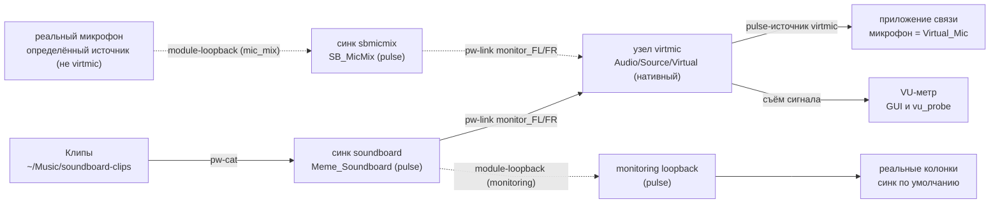

# soundboard

Саундборд для видеозвонков в Linux: создаёт в PipeWire виртуальный микрофон —
нативный узел `Audio/Source/Virtual` с именем `virtmic`, который в списках
устройств приложений показан как **Virtual_Mic** — и проигрывает короткие
аудиоклипы прямо в него. Нажатие горячей клавиши или клик по кнопке «звучит»
в звонке, пока настоящий микрофон продолжает работать. Работает с любым
приложением связи, где выбирается микрофон: Zoom, Google Meet, Telegram,
Jitsi, Discord и т.д.

Интерфейс — GTK4/libadwaita (окно, системный трей) плюс полноценный CLI.

## Как это работает

При запуске программа сама собирает в вашей звуковой подсистеме PipeWire
виртуальный микрофон и маршрутизацию:

1. Клипы играются процессом `pw-cat` в служебный синк `soundboard`
   (pulse-слой, описание «Meme_Soundboard»).
2. Монитор-порты этого синка связываются через `pw-link` со входами
   нативного узла `virtmic` (`Audio/Source/Virtual`, описание
   «Virtual_Mic») — именно этот узел приложения связи видят как настоящий
   микрофон.
3. При включённом «Микс с микрофоном» (`mic_mix`) настоящий микрофон
   попадает в те же входы через микшерную цепочку: pulse-синк `sbmicmix`
   («SB_MicMix») + `module-loopback` с реального микрофона (он держит
   микрофон «бодрствующим» и правильно ресемплирует) + связи
   `sbmicmix:monitor_* -> virtmic:input_*`. Несколько потоков в один вход
   смешиваются софт-микшером адаптера.
4. При включённом «Слышать себя» (`monitoring`) ещё один loopback
   дублирует клипы в реальные колонки (синк по умолчанию).
5. Приложение связи пишет в pulse-источник `virtmic` — это реальный
   (не монитор!) источник, поэтому оно его показывает и записывает.



Сплошные рёбра — постоянный путь; пунктирные существуют только при
включённых `mic_mix` / `monitoring`. Ссылки в `virtmic` пересчитываются при
изменении устройств: mic-mix loopback перецеливается на актуальный реальный
микрофон (источник по умолчанию, иначе первый `alsa_input.*`; никогда
`virtmic` или монитор), monitoring loopback следует за синком по умолчанию.

Ключевые механизмы:

- **Автонастройка графа.** Граф — желаемое состояние (desired state):
  идемпотентный reconcile приводит сессию к нему при каждом запуске GUI,
  перед `play` и по кнопке «Починить граф». Недостающее создаётся, наше
  устаревшее пересоздаётся/удаляется, чужие модули и связи не трогаются.
- **State-файл владения.** Всё, что создала программа, записывается в
  `~/.local/state/soundboard/modules.json` (схема v2: индексы pulse-модулей
  + имена, id нативных узлов + имена). `soundboard down` выгружает только
  записанное там. Потеря файла не фатальна: `up` «усыновляет» модули с
  точно совпадающими аргументами, нативный узел ищется по имени.
- **doctor с самопроверкой.** Команда `soundboard doctor` (и вкладка
  «Дебаг») проверяет pulse-сервер, синк, источник `virtmic` (и что он не
  монитор), нативный узел, связи, отсутствие самопетли, наличие реального
  микрофона и mic-mix/monitoring-цепочки. Код выхода 1 — если найдены
  проблемы.
- **Плеер `pw-cat`.** Один процесс `pw-cat --playback --target soundboard`
  на клип, своя группа процессов, остановка SIGTERM→SIGKILL. CLI умеет
  останавливать чужие запуски: `soundboard stop` находит играющие
  `pw-cat --target soundboard` сканом `/proc`.
- **Планировщик (пер-клиповый interrupt).** Повторное нажатие того же клипа
  перезапускает его (предыдущее проигрывание останавливается), разные клипы
  играют одновременно и накладываются. Тумблер «Перезапускать клип
  повторным нажатием» выключает прерывание — тогда клипы всегда играют
  копиями поверх.
- **Глобальные хоткеи.** Для первых девяти клипов генерируются
  `.desktop`-файлы с `X-KDE-Shortcuts=Alt+N`; их подхватывает Plasma
  (kglobalaccel + ksycoca). Подробности ниже.

## Требования

Проверено на CachyOS / Arch (актуальный PipeWire, Plasma 6):

- `pipewire`, `pipewire-pulse` — звуковая подсистема и pulse-совместимый
  слой;
- утилиты PipeWire `pw-cat`, `pw-cli`, `pw-link` (на Arch — пакет
  `pipewire-audio`);
- `gtk4`, `libadwaita` — библиотеки GUI (сборка и запуск);
- Rust-тулчейн через [mise](https://mise.jdx.dev) (в `mise.toml` закреплён
  `stable`);
- **KDE Plasma** — нужна для системного трея и глобальных хоткеев. Без
  трея приложение работает в оконном режиме (закрытие окна = выход);
  хоткеи без Plasma можно назначить вручную в вашем окружении по таблице
  из `soundboard hotkeys`.

## Установка

```sh
mise install            # rust-тулчейн по mise.toml
cargo install --path .  # бинарник soundboard в ~/.cargo/bin
just clips-install      # скопировать звуки из репозитория (14 клипов, без перезаписи)
just install-desktop    # ярлык приложения и иконку в ~/.local (hicolor)
```

`just clips-install` кладёт встроенные клипы из каталога `clips/` в
`~/Music/soundboard-clips` (файлы, которые уже существуют, не трогаются).

`just install-desktop` устанавливает ярлык
`~/.local/share/applications/org.soundboard.App.desktop` и иконку
(`org.soundboard.App.svg|png` в hicolor), обновляет кэши (`kbuildsycoca6`,
`gtk-update-icon-cache`): после этого в меню приложений появляется
«Soundboard» с фирменной иконкой, а окно и задачи в панели группируются
правильно (StartupWMClass). Повторный запуск просто обновляет файлы.

**Бинарник в PATH.** `cargo install` кладёт его в `~/.cargo/bin` — убедитесь,
что каталог в `PATH` (при желании сделайте симлинк:
`ln -s ~/.cargo/bin/soundboard ~/.local/bin/soundboard`). Файлы хоткеев
встраивают абсолютный путь бинарника на момент регистрации, поэтому работают
независимо от `PATH`; если переместили или переустановили бинарник в другое
место — перерегистрируйте хоткеи (`soundboard hotkeys --write` или кнопка в
GUI).

## Быстрый старт

1. Положите клипы в `~/Music/soundboard-clips` (например,
   `just clips-install`). Форматы: `wav`, `mp3`, `ogg`, `oga`, `flac`,
   `opus`, `m4a`; имя клипа = имя файла без расширения. Подпапки (на один
   уровень) становятся категориями в интерфейсе; поиск — строка «Поиск…».
2. Запустите `soundboard` — GUI стартует и **сам** поднимает аудиограф
   (строка «Граф: OK»; при проблемах появится баннер со ссылкой на
   «Дебаг»).
3. В приложении связи выберите микрофон **Virtual_Mic**
   (Zoom: Настройки → Звук; в Google Meet, Telegram, Jitsi, Discord —
   аналогично). Если в приложении было выбрано другое устройство —
   перевыберите: приложения кэшируют выбранный вход.
4. Жмите кнопки клипов в окне или `Alt+1`…`Alt+9` в любом приложении —
   звук идёт в звонок; VU-метр «Виртуальный микрофон» показывает уровень.
5. Проверка цепочки без звонка: кнопка **Тест** на вкладке «Дебаг» —
   2-секундный тон 440 Гц в виртуальный микрофон.

## Интерфейс

Окно — стек из трёх вкладок (переключение в заголовке окна) плюс баннер
«Граф: проблемы — см. вкладку Дебаг» с кнопкой «Открыть» (появляется при
сбоях графа).

### Вкладка «Саундборд» (повседневная)

- строка **Поиск…** — живой фильтр по имени клипа и категории
  (подстрока без учёта регистра; пустой запрос = все клипы; запрос
  переживает «Обновить»);
- сетка кнопок клипов, сгруппированных по категориям (жирный заголовок =
  имя подпапки, файлы верхнего уровня — «Без категории»; пустые категории
  не показываются; играющие подсвечиваются);
- **Обновить** — пересканировать папку клипов (текущий поисковый запрос
  сохраняется);
- **Стоп всё** — остановить все воспроизведения, запущенные из этого
  приложения;
- слайдер **Громкость** (0–100 %, сохраняется в конфиг);
- **VU-метр виртуального микрофона** — живой уровень сигнала;
- подсказка: «выбери Virtual_Mic как микрофон в приложении связи».

Категории = подпапки в папке клипов на один уровень глубины; вложенные
глубже каталоги не сканируются. Имя клипа — имя файла без расширения и
должно быть уникальным во всех категориях (дубликат: побеждает файл, чей
полный путь идёт первым по алфавиту, остальные игнорируются с
предупреждением). Пример структуры:

```text
~/Music/soundboard-clips/
├── airhorn.wav            → категория «Без категории»
├── приветствия/
│   ├── доброе утро.ogg    → категория «приветствия»
│   └── салам.ogg
└── мемы/
    └── bruh.mp3           → категория «мемы»
```

### Вкладка «Настройки»

- **Микс с микрофоном** — пропускать настоящий микрофон в виртуальный
  (по умолчанию включено);
- **Слышать себя** — дублировать клипы в реальные колонки (выключено по
  умолчанию);
- **Перезапускать клип повторным нажатием** — режим прерывания (включено
  по умолчанию; выключено — повторный клик играет копию поверх).
  Изменение микса/мониторинга сразу перестраивает граф;
- секция **Глобальные хоткеи**: таблица клип → клавиша → команда, строка
  состояния («зарегистрированы» / «не зарегистрированы» / «устарели»),
  кнопки **Включить хоткеи** / **Обновить хоткеи** и **Выключить**.
  Запись файлов и активация в Plasma выполняются автоматически
  (включая `kbuildsycoca6` и принудительное перечитывание
  kglobalaccel);
- **Папка клипов** — текущий путь и кнопка «Открыть папку» (xdg-open).

### Вкладка «Дебаг»

- строка статуса графа и кнопки: **Проверить** (doctor), **Починить граф**
  (reconcile), **Тест** (тон 440 Гц);
- список проверок doctor с деталями каждой (аргументы модулей, id узлов,
  имена источников) — тут же видны сырые предупреждения последнего
  reconcile.

### Трей

- Закрытие окна ([X]) **не** завершает приложение, а прячет окно в трей:
  граф, VU-метр и клипы, запущенные хоткеями, продолжают работать
  (всплывает напоминание «Приложение осталось в трее»).
- Значок в трее (StatusNotifierItem, нативный протокол Plasma): левый клик —
  показать/скрыть окно; меню — «Показать/Скрыть окно», «Стоп всё»,
  строка статуса графа («Граф: OK» / «Граф: проблемы») и «Выход».
- «Выход» (как и SIGINT/SIGTERM) завершает приложение корректно: конфиг
  сохранён, воспроизведения и метр остановлены, **аудиограф остаётся
  работать** для приложения связи.
- Приложение живёт в одном экземпляре (single-instance): повторный запуск
  `soundboard` не плодит второе окно, а показывает (и разворачивает) уже
  открытое.
- Если оболочка не поддерживает трей (нет StatusNotifierWatcher), приложение
  работает в оконном режиме: закрытие окна означает выход.

## CLI

Без подкоманды запускается GUI. Сообщения — на русском.

| Команда | Что делает |
|---|---|
| `soundboard` | GUI: автоподъём графа при старте, сетка клипов, VU-метр, тумблеры, хоткеи, doctor; закрывается в трей. |
| `soundboard up` | Создать или починить аудиограф (идемпотентный reconcile); печатает применённые изменения. |
| `soundboard down` | Выгрузить модули soundboard (чужие модули не трогаются). |
| `soundboard doctor` | Проверить состояние графа; код выхода 1 — если найдены проблемы. |
| `soundboard list` | Показать клипы из настроенного каталога: по строке на клип — `категория/имя` для клипов из подпапок, просто `имя` для файлов верхнего уровня (parse-friendly). |
| `soundboard play <имя>` | Проиграть клип (неблокирующе; граф поднимается автоматически). Имя: точное, уникальное без учёта регистра или уникальный префикс (`soundboard play air` → `airhorn`). |
| `soundboard stop [имя]` | Остановить клип, без имени — всё. Работает даже при недоступном pulse-сервере (ищет `pw-cat` по `/proc`); останавливает и воспроизведения, запущенные из GUI или хоткеями. |
| `soundboard hotkeys` | Таблица клип → `Alt+N` → команда + инструкция ручной привязки для Plasma 6. |
| `soundboard hotkeys --write` | Записать `.desktop`-файлы хоткеев и активировать их в работающей Plasma. |

Примеры:

```sh
soundboard up                 # поднять граф без GUI
soundboard play airhorn       # сыграть клип
soundboard stop               # остановить всё
soundboard hotkeys --write    # Alt+1..9 для первых девяти клипов
soundboard down               # полностью убрать граф
```

## Конфигурация

Файл: `~/.config/soundboard/config.toml` (TOML). Отсутствующий файл —
значения по умолчанию; некорректный TOML, неизвестные ключи или неверные
типы — ошибка; `volume` вне диапазона `0.0..=1.0` обрезается в диапазон
(чтобы старое рукописное значение не мешало запуску), `~` в пути
раскрывается.

| Поле | Тип | По умолчанию | Что делает |
|---|---|---|---|
| `clips_dir` | путь | `~/Music/soundboard-clips` | Каталог клипов (рекурсивно на один уровень: подпапка = категория; скрытые файлы и подпапки игнорируются; имена-дубликаты — предупреждение, остаётся первый по алфавиту полного пути). |
| `volume` | число `0.0..=1.0` | `0.9` | Громкость воспроизведения (передаётся в `pw-cat --volume`). |
| `interrupt_mode` | bool | `true` | Повторное нажатие того же клипа перезапускает его; `false` — играет копию поверх. |
| `mic_mix` | bool | `true` | Пропускать реальный микрофон в виртуальный (через микшерный синк `sbmicmix`). |
| `monitoring` | bool | `false` | Дублировать клипы в реальные колонки (loopback в синк по умолчанию). |

**Персистенция громкости.** Ползунок в GUI сохраняется в `config.toml` с
хвостовым дебаунсом ~300 мс (сохранение происходит, когда ползунок «замолчал»
на это время; при выходе конфиг сохраняется всегда). Это нужно потому, что
каждый клип, запущенный хоткеем, — это отдельный процесс
`soundboard play`, который читает громкость из `config.toml`: ползунок и
хоткеи всегда согласованы.

## Глобальные хоткеи

- Первым девяти клипам (по алфавиту) назначаются `Alt+1`…`Alt+9`; остальные
  клипы показываются в таблице как «без горячих клавиш» (лимит — 9).
- **Когда активны: всегда.** Хоткеи — глобальные, их перехватывает сама
  Plasma (kglobalaccel), поэтому работают в любом приложении и независимо от
  soundboard: окно открыто, висит в трее или полностью закрыто — без разницы.
  Нажатие запускает отдельный процесс `soundboard play <клип>`, который при
  необходимости сам поднимет аудиограф. Открытое приложение этому не мешает
  (одновременная работа безопасна). Нюанс: подсветка играющей кнопки в окне
  обновляется только при запуске из окна; громкость хоткей-процесс берёт из
  `config.toml` — слайдер в окне сохраняется туда же (с задержкой ~0.3 с).
- Как это устроено: для каждого клипа пишется самодостаточный файл
  `~/.local/share/applications/net.local.soundboard.<slug>.desktop` с
  `X-KDE-Shortcuts=Alt+N` (клавиша по умолчанию) и
  `Exec="/абсолютный/путь/soundboard" play "<клип>"`. Конфиг Plasma
  `~/.config/kglobalshortcutsrc` программа никогда не правит — его живёт и
  переписывает сам демон хоткеев.
- Активация автоматическая: после записи выполняется `kbuildsycoca6`, а
  чтобы **работающая** Plasma перечитала файлы, делается «танец»
  скрыть/вернуть файлы с опросом демона через D-Bus
  (`org.kde.KGlobalAccel.allComponents`). Причина: kglobalaccel читает
  `Exec` компонента только один раз и при перезаписи существующего файла
  держит устаревший путь (ловушка stale Exec — хоткей срабатывает, но запуск
  падает «Невозможно найти программу…»). Если демона нет (не Plasma-сессия),
  остаётся только `kbuildsycoca6`.
- Гарантированный запасной вариант активации — выйти из сессии и зайти
  снова. Ручная привязка в обход всего этого: Параметры системы → Клавиатура
  → Комбинации клавиш → «Добавить» → «Команда или сценарий…» (команды — в
  таблице `soundboard hotkeys`).
- Безопасность: файлы помечены маркером генератора; чужой файл с тем же
  именем никогда не трогается; перед перезаписью делается резервная копия
  (`*.bak.<метка времени>`); повторный запуск `--write` идемпотентен.
  «Выключить» в GUI (или удаление файлов) снимает только файлы soundboard.
- Подробное исследование механики хоткеев Plasma 6:
  [`docs/kde-hotkeys.md`](docs/kde-hotkeys.md), решение —
  [ADR 0002](docs/adr/0002-kde-hotkeys-via-desktop-files.md).

## Форматы аудио

Расширения, которые программа считает клипами (без учёта регистра):
`wav`, `mp3`, `ogg`, `oga`, `flac`, `opus`, `m4a`. Декодирует сам `pw-cat`,
проверено вживую на этой машине (воспроизведение в граф, замер пика
захвата):

| Формат | Расширение | Проверено | Замер |
|---|---|---|---|
| WAV PCM | `wav` | да | пик 0.500 FS — точно совпал с исходником |
| MP3 | `mp3` | да | декодируется (обычная «рябь» кодека) |
| Ogg Vorbis | `ogg`, `oga` | да | декодируется (рябь кодека) |
| FLAC | `flac` | да | декодируется (пик точный) |
| Opus, AAC | `opus`, `m4a` | да (реальные клипы) | ogg-opus: 19 из 21 играют нативно; **2 файла** (ogg-opus от старого ffmpeg с «кривой» грануляцией первой страницы) pw-cat отвергает — приложение автоматически перекодирует их через ffmpeg в wav и играет из кэша |

**Автоперекодирование.** Если `pw-cat` не смог декодировать клип (умер в
первую секунду запуска) и в системе есть `ffmpeg`, приложение один раз
перекодирует файл в wav 48 кГц/стерео в
`~/.cache/soundboard/transcoded/` (ключ кэша — mtime+size исходника:
изменили файл — перекодируется заново) и играет из кэша. Если ffmpeg нет —
видна исходная ошибка декодирования. Аудит папки клипов: `just clips-check`
(осторожно: каждый клип коротко проигрывается).

Детали и методика: [`docs/pipewire-recipe.md`](docs/pipewire-recipe.md).

## Устранение неполадок

- **Гул микрофона при включённом миксе.** Признак самопетли: виртуальный
  микрофон замкнут сам на себя (`virtmic -> virtmic`) — уровень уходит в
  цифровое насыщение. Нажмите **Починить граф** (или `soundboard up`):
  reconciler уничтожает самопетли, а текущая топология микса вообще не
  создаёт прямых связей микрофона в `virtmic` — микрофон идёт через
  микшерный синк `sbmicmix`
  ([ADR 0005](docs/adr/0005-mic-mix-via-mixer-sink.md)). Проверка
  «на virtmic нет самопетли» есть в doctor.
- **Virtual_Mic пропал из списка микрофонов приложения.** Запустите
  `soundboard doctor` (или откройте «Дебаг»), дождитесь «все проверки
  пройдены», затем заново откройте настройки звука в приложении связи и
  выберите Virtual_Mic — приложения перечитывают список устройств при
  открытии настроек и кэшируют ранее выбранный вход.
- **Хоткеи не срабатывают.** Проверьте: `soundboard hotkeys` (таблица и
  состояние), `soundboard hotkeys --write` (переписать и активировать заново),
  затем Параметры системы → Клавиатура → Комбинации клавиш → раздел
  «Команды». Если после перезаписи путей к бинарнику клавиши «стреляют», но
  ничего не происходит — это ловушка stale Exec; повторный `--write` делает
  принудительное перечитывание, в крайнем случае перелогиньтесь. Диагностика:
  `journalctl --user | grep "Невозможно найти программу"`.
- **Клип «не воспроизводится» с ошибкой про формат** (`sndfile: … file is
  malformed` — чаще всего ogg-файлы от старых ffmpeg). Это не «не тот
  формат»: контейнер валидный, но libsndfile (декодер `pw-cat`) строг к
  грануляции страниц. Приложение само перекодирует такой клип через ffmpeg
  в wav и играет; убедитесь только, что `ffmpeg` установлен. Диагностика
  всей папки: `just clips-check`.
- **Звук клипов слышен в колонках.** Включён тумблер «Слышать себя» — это и
  есть локальный мониторинг, выключите его в «Настройках».
- **Клап/эхо в звонке.** Физика: колонки слышит настоящий микрофон
  (мониторинг тут ни при чём). Уменьшите громкость колонок, отодвиньте
  микрофон или используйте наушники.
- **Граф пропал после перезапуска PipeWire.** Нативный узел и связи живут
  в сессии демона и умирают вместе с ним. `soundboard up` (или перезапуск
  GUI) пересобирает всё заново.
- **Нет сигнала, хотя граф «зелёный».** Проверьте источник напрямую:
  `cargo run --example vu_probe --` (по умолчанию слушает `virtmic`,
  печатает ~10 уровней в секунду, Ctrl+C — выход). Пики есть при
  воспроизведении — проблема на стороне приложения связи; пиков нет —
  смотрите `pactl list sink-inputs` во время воспроизведения.
- **Осторожно с ручной сборкой виртуального микрофона.** Варианты «своими
  руками» через pulse-слой (`module-null-sink media.class=Audio/Source/Virtual`
  или `pw-loopback`) проверено сломаны (тихо перецеливаются в синк по
  умолчанию). Используйте `soundboard up`; разбор — в
  [`docs/pipewire-recipe.md`](docs/pipewire-recipe.md).

## Ограничения

- Глобальных хоткеев ровно 9 (`Alt+1`…`Alt+9`) — только для первых девяти
  клипов по алфавиту.
- Приложения связи кэшируют выбранное устройство: после пересборки графа
  Virtual_Mic нужно перевыбрать (или заново открыть настройки звука).
- Нативный узел `virtmic` не переживает рестарт демона PipeWire — лечится
  `soundboard up` (GUI делает это сам при запуске).
- При включённом «Микс с микрофоном» реальный микрофон не «засыпает»
  (loopback держит поток захвата) — небольшой расход энергии в простое.
- «Стоп всё» в GUI и трее останавливает только воспроизведения, запущенные
  этим приложением; `soundboard stop` из CLI останавливает всё, что играет
  в целевой синк, включая запуски других процессов.

## Разработка

```sh
just build           # cargo build
just test            # cargo test
just lint            # cargo fmt --check + clippy -D warnings
just run             # cargo run (GUI)
just clips-install   # клипы из репозитория в ~/Music/soundboard-clips
```

- Тулчейн — только через mise (`mise.toml` закрепляет `stable`); системные
  пакеты не ставим.
- Отладочный пример: `cargo run --example vu_probe -- [источник]` — живой
  пик-пробник произвольного pulse-источника (по умолчанию `virtmic`).
- Раскладка `src/`: `main.rs` (точка входа, диспетчер CLI), `cli.rs`
  (определения команд), `graph.rs` (reconcile графа в два слоя + doctor +
  state-файл), `player.rs` (процессы `pw-cat`, межпроцессная остановка),
  `scheduler.rs` (политика прерываний), `clips.rs` (реестр клипов),
  `config.rs` (конфиг), `meter.rs` (VU-метр), `hotkeys.rs`
  (.desktop-файлы хоткеев), `ui/` (окно, аудио-воркер, трей, живое
  обновление kglobalaccel). Полная карта и правила проекта — `AGENTS.md`.
- Документация: `docs/pipewire-recipe.md` (контракт аудиографа),
  `docs/kde-hotkeys.md` (исследование хоткеев Plasma),
  `docs/hld.md` (архитектура), `docs/adr/` — архитектурные решения
  (дополняются, не переписываются: Контекст → Решение → Альтернативы →
  Последствия).
- Коммиты — conventional (`feat:`, `fix:`, `docs:`, …).

## Как это устроено внутри

Коротко; полные детали — в [`docs/hld.md`](docs/hld.md) и
[`docs/pipewire-recipe.md`](docs/pipewire-recipe.md).

- **Почему нативный узел.** Приложения связи (проверено на Zoom)
  **фильтруют** монитор-источники из списков микрофонов. Старая схема
  «null-sink + захват его монитора `virtmic.monitor`» давала источник,
  которого приложения просто не показывали. Нативный узел
  `Audio/Source/Virtual`, созданный `pw-cli create-node adapter`,
  pipewire-pulse отдаёт как **настоящий** источник `virtmic` (не монитор,
  флаг HARDWARE) — его приложения показывают и пишут. По этой же причине не
  работает pulse-вариант `module-null-sink media.class=Audio/Source/Virtual`
  (не регистрирует pulse-синк; loopback-ы молча падают в синк по умолчанию)
  и `pw-loopback` (неверно привязывает обе стороны). Разбор битых вариантов —
  в рецепте и [ADR 0004](docs/adr/0004-virtmic-native-source-node.md).
- **Реальный микрофон** для микса выбирается чистой функцией: кандидаты —
  все pulse-источники, кроме `virtmic` и мониторов; приоритет — источник по
  умолчанию, иначе первый `alsa_input.*`; никого — mic-путь пропускается с
  предупреждением, doctor падает с внятным сообщением. Прямые связи
  `<мик>:capture_* -> virtmic:input_*` никогда не создаются (проверенные
  ловушки: ENOENT у спящего ALSA-микрофона и самопетля, когда источником по
  умолчанию назначен сам `virtmic`).
- **State-файл владения**
  (`~/.local/state/soundboard/modules.json`, схема v2) — единственный
  источник истины о том, что в pulse-сессии создано soundboard:
  индексы и ожидаемые имена модулей плюс id/имена нативных узлов.
  Модуль считается «нашим», только если он в файле, существует и имеет
  ожидаемую форму; всё остальное — чужое и не выгружается. Порванный или
  устаревший файл читается как пустое состояние и восстанавливается
  «усыновлением» на следующем `up`.
- **doctor** проверяет граф с обеих сторон (pulse — через libpulse,
  нативная — через `pw-cli`/`pw-link`): сервер, синк `soundboard`, источник
  `virtmic` и его «не-мониторность», единственность узла, наличие связей,
  отсутствие самопетли, реальный микрофон, цепочка микса (при `mic_mix`),
  monitoring loopback (при `monitoring`). Часть проверок помечается
  «пропущено», если pulse-сервер недоступен.
