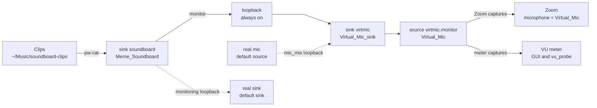
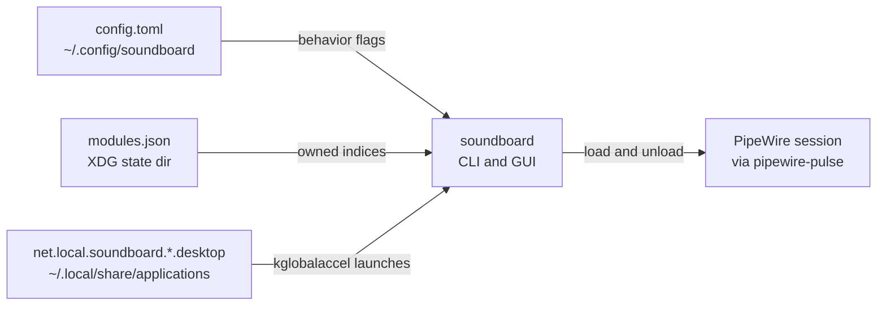

# soundboard — High-Level Design

A Rust + GTK4 soundboard that creates a PipeWire virtual microphone and
plays short audio clips into it, for Zoom and other conferencing apps on
Linux. The audio topology is the live-verified contract in
[`docs/pipewire-recipe.md`](pipewire-recipe.md); this document maps that
contract onto the code. Keep it in sync with the code in the same commit.

## Components

| Component | Code | Responsibility |
|---|---|---|
| CLI | `src/main.rs`, `src/cli.rs` | Subcommands `up`/`down`/`doctor`/`list`/`play`/`stop`/`hotkeys`; no subcommand launches the GUI. Loads config, prints reports. |
| GUI | `src/ui/window.rs`, `src/ui/mod.rs` | libadwaita window: doctor status rows, repair/test/stop buttons, VU `LevelBar`, clip grid (FlowBox), volume slider, mic-mix/monitoring/interrupt toggles, error toasts. Sends commands only — nothing blocking on the UI thread. |
| Audio worker | `src/ui/worker.rs` | One thread owning all blocking audio: pulse session, graph, player, scheduler, meter. Auto-reconciles + runs doctor at startup; restarts the meter on every successful reconcile; persists config; stops playbacks on shutdown while deliberately leaving the graph up. |
| Graph manager | `src/graph.rs` | Idempotent desired-state reconcile of null-sinks and loopbacks over the PulseAudio/PipeWire session; module-ownership state file; `doctor` checks; foreign modules are never unloaded. |
| Player | `src/player.rs` | One `pw-cat --playback --target soundboard` subprocess per clip (own process group, SIGTERM→SIGKILL stop); cross-process stop by scanning `/proc/*/cmdline`. |
| Scheduler | `src/scheduler.rs` | Pure playback policy: per-clip interrupt vs. overlap, stop-one/stop-all decisions over opaque handles. |
| Meter | `src/meter.rs` | Peak meter capturing `virtmic.monitor` on its own thread (~30 Hz, throttled) into an async channel for the UI. |
| Clips registry | `src/clips.rs` | Non-recursive scan of the clips directory (wav/mp3/ogg/oga/flac/opus/m4a, case-insensitive); name resolution: exact, then unique case-insensitive/prefix. |
| Hotkeys | `src/hotkeys.rs` | Clip → `Alt+N` → command table; `--write` generates KDE `.desktop` shortcut files (see [ADR 0002](adr/0002-kde-hotkeys-via-desktop-files.md)). |
| Config | `src/config.rs` | TOML at `~/.config/soundboard/config.toml`; defaults when missing, error on malformed, volume clamped. |
| Module state | `$XDG_STATE_HOME/soundboard/modules.json` | Persistent registry of the module indices soundboard loaded; the only modules `down` will ever unload (see `src/graph.rs` docs). |

## Audio topology (verified)

Exactly the graph from [`docs/pipewire-recipe.md`](pipewire-recipe.md): the
clips sink, the virtual-mic sink, one always-on loopback, and two optional
loopbacks (`mic_mix`, `monitoring`) resolved against the current default
devices at reconcile time. Zoom captures `virtmic.monitor` (device
description "Virtual_Mic"); the GUI meter captures the same source.

Solid edges are the always-on path; dotted edges exist only while the
`mic_mix` / `monitoring` config flags are on (the loopbacks are re-targeted
to the current default source/sink on every reconcile). All four pulse
nodes negotiate `float32le 2ch 48000Hz`; the meter requests mono f32 and
lets the server convert.

Deliberately NOT used (live-tested broken variants, see the recipe):
`media.class=Audio/Source/Virtual` null-sinks and `pw-loopback` — both
silently fall back to the default sink.

## Configuration surface

Config, module state and generated hotkey files are plain files the app
reads and writes around the audio session:

- `config.toml`: `clips_dir` (`~/Music/soundboard-clips`), `volume` (0.9,
  clamped to 0.0..=1.0), `interrupt_mode` (true), `mic_mix` (true),
  `monitoring` (false). Missing file → defaults; malformed → error.
- `modules.json`: indices + expected names of loaded modules; written after
  every reconcile/teardown; a missing/corrupt file is treated as empty and
  recovered by adoption on the next `up`.
- `net.local.soundboard.*.desktop`: written only by `soundboard hotkeys
  --write`; marker-checked, backed up, idempotent
  ([ADR 0002](adr/0002-kde-hotkeys-via-desktop-files.md)).

## Key flows

- **Startup (GUI)**: worker reconcile → doctor report + meter start →
  `GuiMsg::GraphUp`/`Status`; the grid is rebuilt on every report, so new
  clip files appear without a manual rescan.
- **Play (CLI)**: scan clips → resolve name → reconcile graph (auto-setup;
  doctor dump on failure) → per-clip interrupt via `/proc` when
  `interrupt_mode` → spawn `pw-cat`, exit.
- **Play (GUI)**: worker resolves + schedules → interrupted handles stopped
  first → `pw-cat` spawned → playing set published to highlight the grid.
- **Shutdown (GUI)**: close request (also routed from SIGINT/SIGTERM) →
  worker persists config, stops meter + playbacks → window destroyed; the
  audio graph stays up for Zoom. `soundboard down` is the explicit teardown.

## Decision records

Architecture decisions live in [`docs/adr/`](adr/) (append-only):
0001 pw-cat player process model · 0002 KDE hotkeys via desktop files ·
0003 GUI toolkit GTK4.
