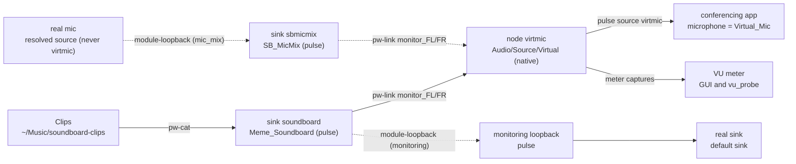
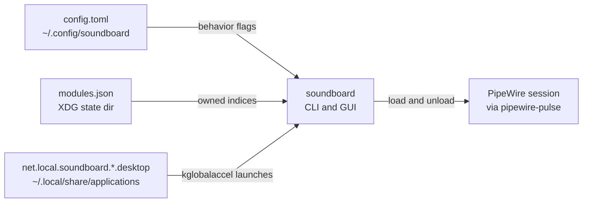

# soundboard — High-Level Design

A Rust + GTK4 soundboard that creates a PipeWire virtual microphone and
plays short audio clips into it, for conferencing apps (Zoom, Google Meet,
Telegram, Jitsi, …) on Linux. The audio topology is the live-verified
contract in
[`docs/pipewire-recipe.md`](pipewire-recipe.md); this document maps that
contract onto the code. Keep it in sync with the code in the same commit.

## Components

| Component | Code | Responsibility |
|---|---|---|
| CLI | `src/main.rs`, `src/cli.rs` | Subcommands `up`/`down`/`doctor`/`list`/`play`/`stop`/`hotkeys`; no subcommand launches the GUI. Loads config, prints reports. |
| Tray | `src/ui/tray.rs` | StatusNotifierItem via ksni 0.3 (blocking): icon, tooltip and Russian menu on its own thread; menu actions send `TrayCmd`s to the GTK main loop (toggle window, stop all, graceful quit); graph-status line updated from `GuiMsg::Status`. Close-to-tray: the window hides, the app (graph + meter + hotkey plays) keeps running. |
| Hotkey live refresh | `src/ui/kglobalaccel.rs` | Session glue: after the hotkey desktop files are rewritten, makes a running kglobalacceld re-read them (hide/restore + two `kbuildsycoca6` runs, `gdbus allComponents` polling); used by CLI `--write` and the GUI register flow. |
| GUI | `src/ui/window.rs`, `src/ui/mod.rs` | libadwaita window: doctor status rows, repair/test/stop buttons, VU `LevelBar`, clip grid (FlowBox), volume slider, mic-mix/monitoring/interrupt toggles, error toasts. Sends commands only — nothing blocking on the UI thread. |
| Audio worker | `src/ui/worker.rs` | One thread owning all blocking audio: pulse session, graph, player, scheduler, meter. Auto-reconciles + runs doctor at startup; restarts the meter on every successful reconcile; persists config; stops playbacks on shutdown while deliberately leaving the graph up. |
| Graph manager | `src/graph.rs` | Idempotent desired-state reconcile over TWO layers: pulse null-sinks + loopbacks (libpulse: memes sink, mic-mix mixer sink `sbmicmix` + mic loopback, monitoring loopback), and the native `Audio/Source/Virtual` node `virtmic` + `pw-link` feeds (`pw-cli`/`pw-link` subprocesses); module/node ownership state file; `doctor` checks; foreign modules and links are never touched. |
| Player | `src/player.rs` | One `pw-cat --playback --target soundboard` subprocess per clip (own process group, SIGTERM→SIGKILL stop); cross-process stop by scanning `/proc/*/cmdline`. |
| Scheduler | `src/scheduler.rs` | Pure playback policy: per-clip interrupt vs. overlap, stop-one/stop-all decisions over opaque handles. |
| Meter | `src/meter.rs` | Peak meter capturing `virtmic` (the native virtual source) on its own thread (~30 Hz, throttled) into an async channel for the UI. |
| Clips registry | `src/clips.rs` | Non-recursive scan of the clips directory (wav/mp3/ogg/oga/flac/opus/m4a, case-insensitive); name resolution: exact, then unique case-insensitive/prefix. |
| Hotkeys | `src/hotkeys.rs` | Clip → `Alt+N` → command table; `--write` generates KDE `.desktop` shortcut files (see [ADR 0002](adr/0002-kde-hotkeys-via-desktop-files.md)). |
| Config | `src/config.rs` | TOML at `~/.config/soundboard/config.toml`; defaults when missing, error on malformed, volume clamped. |
| Module state | `$XDG_STATE_HOME/soundboard/modules.json` | Persistent registry of the pulse module indices and native node ids soundboard created (schema v2); `down` unloads/destroys only these plus name/pair-matched native objects (see `src/graph.rs` docs). |

## Audio topology (verified)

The graph from [`docs/pipewire-recipe.md`](pipewire-recipe.md): the clips
sink `soundboard` (pulse), the NATIVE virtual source node `virtmic`
(`Audio/Source/Virtual`, description "Virtual_Mic") fed by `pw-link` port
pairs, and two optional passthroughs: the mic-mix chain (`mic_mix`, ADR
0005 — real mic → pulse module-loopback → mixer sink `sbmicmix` → native
monitor links into the same virtmic inputs) and the pulse monitoring
loopback to the real speakers. The conferencing app captures the pulse
source `virtmic` — a real source, NOT a monitor (such apps filter monitor
sources; that is why the native node exists, ADR 0004). The GUI meter
captures the same source.

Solid edges are the always-on path; dotted edges exist only while the
`mic_mix` / `monitoring` config flags are on. The mic-mix loopback is
re-targeted when the resolved real mic changes (default source if usable,
else the first `alsa_input.*`; never `virtmic` or a monitor — ADR 0005),
the monitoring loopback follows the default sink. Links into `virtmic` are
mixed by the adapter's soft-mixer.

Deliberately NOT used (live-tested broken variants, see the recipe): the
pulse-level `module-null-sink media.class=Audio/Source/Virtual` (no pulse
sink registered; loopbacks fall back to the default sink) and
`pw-loopback` (mis-binds both halves). The native pw-cli node is the
verified replacement ([ADR 0004](adr/0004-virtmic-native-source-node.md)).

## Configuration surface

Config, module state and generated hotkey files are plain files the app
reads and writes around the audio session:

- `config.toml`: `clips_dir` (`~/Music/soundboard-clips`), `volume` (0.9,
  clamped to 0.0..=1.0), `interrupt_mode` (true), `mic_mix` (true),
  `monitoring` (false). Missing file → defaults; malformed → error.
- `modules.json`: schema v2 — pulse module indices + expected names and
  native node ids + names; written after every reconcile/teardown; a
  missing/corrupt/older-version file is treated as empty and recovered by
  adoption on the next `up` (pulse: exact args; native: `node.name` /
  port pairs).
- `net.local.soundboard.*.desktop`: written only by `soundboard hotkeys
  --write`; marker-checked, backed up, idempotent
  ([ADR 0002](adr/0002-kde-hotkeys-via-desktop-files.md)).

## Key flows

- **Startup (GUI)**: worker reconcile → doctor report + meter start →
  `GuiMsg::GraphUp`/`Status`; the grid is rebuilt on every report, so new
  clip files appear without a manual rescan.
- **Play (CLI)**: scan clips → resolve name → reconcile graph (auto-setup;
  doctor dump on failure) → per-clip interrupt via `/proc` when
  `interrupt_mode` → spawn `pw-cat`, exit.
- **Play (GUI)**: worker resolves + schedules → interrupted handles stopped
  first → `pw-cat` spawned → playing set published to highlight the grid.
- **Shutdown (GUI)**: close request (also routed from SIGINT/SIGTERM) →
  worker persists config, stops meter + playbacks → window destroyed; the
  audio graph stays up for the conferencing app. `soundboard down` is the
  explicit teardown.

## Decision records

Architecture decisions live in [`docs/adr/`](adr/) (append-only):
0001 pw-cat player process model · 0002 KDE hotkeys via desktop files ·
0003 GUI toolkit GTK4 · 0004 virtmic as a native Audio/Source/Virtual node ·
0005 mic-mix via the sbmicmix mixer sink.
