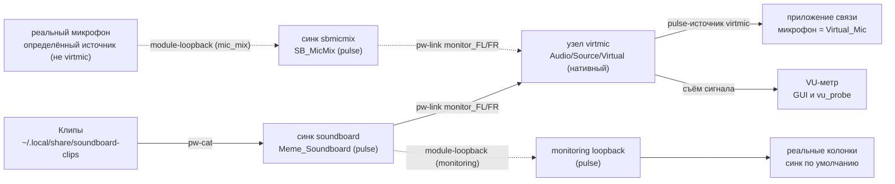
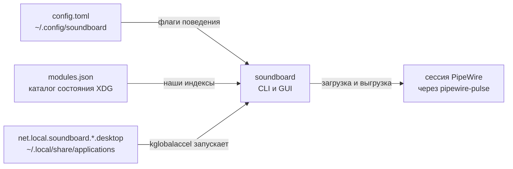

# soundboard — высокоуровневый дизайн (HLD)

Саундборд на Rust + GTK4, создающий в PipeWire виртуальный микрофон и
проигрывающий в него короткие аудиоклипы, для приложений связи (Zoom,
Google Meet, Telegram, Jitsi, …) на Linux. Аудиотопология — живьём
проверенный контракт в [`docs/pipewire-recipe.md`](pipewire-recipe.md);
этот документ привязывает контракт к коду. Держать в актуальном состоянии в
одном коммите с кодом.

## Компоненты

| Компонент | Код | Ответственность |
|---|---|---|
| CLI | `src/main.rs`, `src/cli.rs` | Подкоманды `up`/`down`/`doctor`/`list`/`play`/`stop`/`hotkeys`; без подкоманды — GUI. Загружает конфиг, печатает отчёты. |
| Трей | `src/ui/tray.rs` | StatusNotifierItem через ksni 0.3 (blocking): значок, подсказка и русское меню в своём потоке; действия меню шлют `TrayCmd` в главный цикл GTK (показать/скрыть окно, стоп всё, корректный выход); строка статуса графа обновляется из `GuiMsg::Status`. Закрытие окна прячет его в трей, приложение (граф + метр + клипы по хоткеям) продолжает работать. |
| Живое обновление хоткеев | `src/ui/kglobalaccel.rs` | Клей сессии: после перезаписи `.desktop`-файлов хоткеев заставляет работающий kglobalacceld перечитать их (скрыть/вернуть + два `kbuildsycoca6`, опрос `gdbus allComponents`); используется и CLI `--write`, и регистрацией в GUI. |
| GUI | `src/ui/window.rs`, `src/ui/mod.rs` | Окно libadwaita: строки проверок doctor, кнопки починки/теста/стопа, VU `LevelBar`, сетка клипов (FlowBox), слайдер громкости, тумблеры микс/мониторинг/прерывание, тосты об ошибках. Только шлёт команды — ничего блокирующего в потоке UI. |
| Аудио-воркер | `src/ui/worker.rs` | Один поток, владеющий всем блокирующим аудио: pulse-сессия, граф, плеер, планировщик, метр. При старте сам делает reconcile + doctor; перезапускает метр после каждого успешного reconcile; сохраняет конфиг; на выключении останавливает воспроизведения, сознательно оставляя граф работать. |
| Менеджер графа | `src/graph.rs` | Идемпотентное приведение желаемого состояния к сессии в ДВУХ слоях: pulse null-sink + loopback (libpulse: клип-синк, микшерный синк `sbmicmix` + mic-loopback, monitoring loopback) и нативный узел `virtmic` (`Audio/Source/Virtual`) + связи через `pw-link` (подпроцессы `pw-cli`/`pw-link`); state-файл владения модулями/узлами; проверки `doctor`; чужие модули и связи не трогаются. |
| Плеер | `src/player.rs` | Один подпроцесс `pw-cat --playback --target soundboard` на клип (своя группа процессов, остановка SIGTERM→SIGKILL); межпроцессный останов сканом `/proc/*/cmdline`. |
| Планировщик | `src/scheduler.rs` | Чистая политика воспроизведения: пер-клиповое прерывание против наложения, решения stop-one/stop-all над непрозрачными хэндлами. |
| Метр | `src/meter.rs` | Пик-метр, захватывающий `virtmic` (нативный виртуальный источник) в своём потоке (~30 Гц, с троттлингом) в async-канал для UI. |
| Реестр клипов | `src/clips.rs` | Нерекурсивный скан каталога клипов (wav/mp3/ogg/oga/flac/opus/m4a, без учёта регистра); разрешение имени: точное, затем уникальное без учёта регистра/по префиксу. |
| Хоткеи | `src/hotkeys.rs` | Таблица клип → `Alt+N` → команда; `--write` генерирует KDE `.desktop`-файлы (см. [ADR 0002](adr/0002-kde-hotkeys-via-desktop-files.md)). |
| Конфиг | `src/config.rs` | TOML в `~/.config/soundboard/config.toml`; отсутствие файла — дефолты, битый файл — ошибка, volume обрезается. |
| State модулей | `$XDG_STATE_HOME/soundboard/modules.json` | Постоянный реестр индексов pulse-модулей и id нативных узлов, созданных soundboard (схема v2); `down` выгружает/уничтожает только их плюс нативные объекты, найденные по имени/паре портов (см. доки `src/graph.rs`). |

## Аудиотопология (проверено)

Граф из [`docs/pipewire-recipe.md`](pipewire-recipe.md): клип-синк
`soundboard` (pulse), НАТИВНЫЙ узел виртуального источника `virtmic`
(`Audio/Source/Virtual`, описание «Virtual_Mic»), питаемый парами портов
через `pw-link`, и два опциональных прохода: цепочка микса (`mic_mix`,
ADR 0005 — реальный микрофон → pulse module-loopback → микшерный синк
`sbmicmix` → нативные связи монитора в те же входы `virtmic`) и pulse
monitoring loopback в реальные колонки. Приложение связи захватывает
pulse-источник `virtmic` — реальный источник, НЕ монитор (такие приложения
фильтруют мониторы; именно поэтому существует нативный узел, ADR 0004).
Метр GUI захватывает тот же источник.

Сплошные рёбра — постоянный путь; пунктирные существуют только при
включённых `mic_mix` / `monitoring`. mic-mix loopback перецеливается при
смене определённого реального микрофона (источник по умолчанию, если
пригоден, иначе первый `alsa_input.*`; никогда `virtmic` или монитор —
ADR 0005), monitoring loopback следует за синком по умолчанию. Связи в
`virtmic` смешиваются софт-микшером адаптера.

Сознательно НЕ используется (проверенные живьём битые варианты, см.
рецепт): pulse-овый `module-null-sink media.class=Audio/Source/Virtual`
(не регистрирует pulse-синк; loopback-ы падают в синк по умолчанию) и
`pw-loopback` (неверно привязывает обе стороны). Нативный pw-cli узел —
проверенная замена ([ADR 0004](adr/0004-virtmic-native-source-node.md)).

## Конфигурационная поверхность

Конфиг, state модулей и сгенерированные файлы хоткеев — обычные файлы,
которые приложение читает и пишет вокруг аудиосессии:

- `config.toml`: `clips_dir` (`~/.local/share/soundboard-clips`), `volume`
  (0.9, обрезается в 0.0..=1.0), `interrupt_mode` (true), `mic_mix` (true),
  `monitoring` (false). Нет файла → дефолты; битый → ошибка.
- `modules.json`: схема v2 — индексы pulse-модулей + ожидаемые имена и
  id/имена нативных узлов; пишется после каждого reconcile/teardown;
  отсутствующий/битый/устаревший файл читается как пустое состояние и
  восстанавливается усыновлением на следующем `up` (pulse: точные аргументы;
  натив: `node.name` / пары портов).
- `net.local.soundboard.*.desktop`: пишутся только `soundboard hotkeys
  --write`; с маркером-проверкой, с бэкапами, идемпотентно
  ([ADR 0002](adr/0002-kde-hotkeys-via-desktop-files.md)).

## Ключевые потоки

- **Запуск (GUI)**: воркер делает reconcile → отчёт doctor + запуск метра →
  `GuiMsg::GraphUp`/`Status`; сетка перестраивается по каждому отчёту, новые
  файлы клипов появляются без ручного пересканирования.
- **Play (CLI)**: скан клипов → разрешение имени → reconcile графа
  (автонастройка; при неудаче — дамп doctor) → пер-клиповое прерывание через
  `/proc` при `interrupt_mode` → запуск `pw-cat`, выход.
- **Play (GUI)**: воркер разрешает + планирует → прерванные хэндлы
  останавливаются первыми → запускается `pw-cat` → множество играющих
  публикуется, сетка подсвечивается.
- **Выключение (GUI)**: запрос закрытия (также от SIGINT/SIGTERM) → воркер
  сохраняет конфиг, останавливает метр + воспроизведения → окно
  уничтожается; аудиограф остаётся работать для приложения связи.
  `soundboard down` — явная разборка.

## Записи решений

Архитектурные решения лежат в [`docs/adr/`](adr/) (только дополнение):
0001 процессная модель плеера pw-cat · 0002 хоткеи KDE через desktop-файлы ·
0003 GUI-тулкит GTK4 · 0004 virtmic как нативный узел
Audio/Source/Virtual · 0005 mic-mix через микшерный синк sbmicmix.
